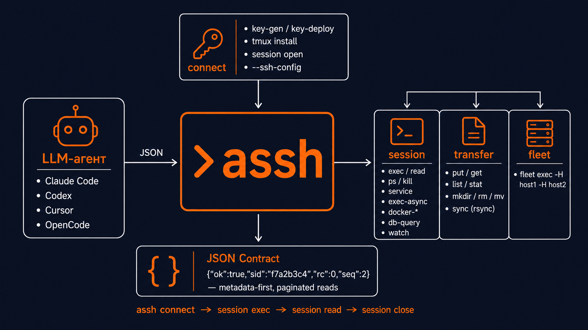

# assh

[](https://github.com/izzzzzi/agent-assh/actions/workflows/ci.yml)
[](https://github.com/izzzzzi/agent-assh/releases)
[](https://www.npmjs.com/package/agent-assh)
[](LICENSE)

Language: English | [Русский](README.md)

SSH workflow helper for LLM agents.

`assh` bootstraps SSH access, opens a persistent remote `tmux` session, and keeps large SSH output out of the agent context. Commands return compact JSON metadata first; agents read only the lines they need.

<p align="center">
  
</p>

## Quick Start

```bash
npm i -g agent-assh

# key login
assh connect -H 203.0.113.10 -u root -i ~/.ssh/id_ed25519 -n deploy

# or first contact with a password: assh installs its own key, later logins use it
export TARGET_PASS="..."
assh connect -H 203.0.113.10 -u root -E TARGET_PASS -n deploy
unset TARGET_PASS
```

If key login already works, `assh connect` does not read `TARGET_PASS`.

If you have a provider server-info block, save it to a local file (mode `0600`) and let `assh` parse it:

```bash
assh connect-info --file server.txt -n deploy
```

For repeated work on the same host, `--reuse` returns a live session with the same host, user, key and profile instead of opening another one. If there is none, it bootstraps normally:

```bash
assh connect -H HOST -u USER -i KEY -n deploy --reuse
```

`connect` returns a session id and `next_commands`:

```json
{
  "ok": true,
  "host": "203.0.113.10",
  "user": "root",
  "identity": "/home/me/.ssh/id_ed25519",
  "key_deployed": false,
  "key_verified": true,
  "tmux_installed": true,
  "sid": "f7a2b3c4",
  "session": "deploy",
  "tmux_name": "assh_f7a2b3c4",
  "next_commands": {
    "exec": "assh session exec -s f7a2b3c4 -- pwd",
    "read": "assh session read -s f7a2b3c4 --seq 1 --limit 50",
    "list": "assh session list",
    "close": "assh session close -s f7a2b3c4"
  }
}
```

Continue through the session API:

```bash
assh session exec -s f7a2b3c4 -- "pwd"
# {"ok":true,"rc":0,"seq":1,"stdout_lines":1,"stderr_lines":0,...}
assh session read -s f7a2b3c4 --seq 1 --limit 50
```

`transfer` and `exec` address a host, not a session: pass them `-H`, `-u` and the `identity` from the connect response as `-i`.

For scripts delivered through heredoc/stdin, use the explicit bounded mode (up to 4 MiB):

```bash
cat script.sh | assh session exec -s f7a2b3c4 --stdin -- "bash -s"
```

`session exec` waits 300 seconds by default (`-t SECONDS`). After a `timeout` the command is still running in the session, so do not retry it blindly: read its `seq` later. Start long or open-ended work as a job instead:

```bash
assh session exec-async -s f7a2b3c4 -- "make build"
assh session job-status -s f7a2b3c4 --job-id JOB_ID   # status, rc, last lines of output
assh session job-cancel -s f7a2b3c4 --job-id JOB_ID
```

When the work is done, close the session: `assh session close -s f7a2b3c4`.

`assh version --check` reports whether a newer release exists.

## Installing the assh Skill into AI Agents

The assh skill teaches AI coding agents to use assh for SSH work. It only carries
instructions: the CLI itself is installed with `npm i -g agent-assh`, and the skill
tells the agent to do that when `assh` is missing.

| Agent | Install |
| --- | --- |
| **Claude Code** | `/plugin marketplace add izzzzzi/agent-assh` then `/plugin install assh@assh` |
| **Codex** | `codex plugin marketplace add izzzzzi/agent-assh` then `codex plugin add assh@assh` |
| **Cursor** | Copy `.cursor/rules/assh.mdc` to your project's `.cursor/rules/` |
| **Cline** | Copy `.clinerules/assh.md` into your project's `.clinerules/` |
| **Copilot CLI** | `copilot plugin marketplace add izzzzzi/agent-assh` then `copilot plugin install assh@assh` |
| **OpenCode** | Copy `skills/assh/` to `.opencode/skills/assh/` in your project, or to `~/.config/opencode/skills/assh/` |
| **Pi** | `pi install git:github.com/izzzzzi/agent-assh` |
| **Any agent** | Copy `AGENTS.md` into your project, or paste `SYSTEM_PROMPT_snippet.md` into the system prompt |

Via `ctx7`:

```bash
ctx7 skills install /izzzzzi/agent-assh assh
```

## What connect Does

`assh connect`:

- uses the key at `--identity` (default `~/.ssh/id_agent_ed25519`) and creates it if it does not exist;
- tries key login first;
- uses `--password-env` only when key login fails;
- deploys the public key and verifies key login;
- probes remote capabilities;
- installs `tmux` non-interactively unless `--no-install-tmux` is set;
- runs safe cleanup for old trusted `assh` sessions unless `--no-gc` is set;
- opens a trusted `tmux` session and saves local registry metadata.

## Commands

- `assh connect`: first-contact bootstrap and session open.
- `assh connect-info`: parse a pasted provider server-info block and connect.
- `assh prompt`: print the agent instructions (the same text as the skill). `assh --help` prints a JSON manifest for agents; `assh <command> --help` prints flags.
- `assh session exec|read|close|gc`: persistent tmux workflow.
- `assh session ps|kill`: process management.
- `assh session service`: service management (status/restart/start/stop/logs).
- `assh session exec-async|job-status|job-cancel`: background jobs.
- `assh session watch`: human observability into the agent's tmux session.
- `assh session list`: list local sessions from the registry.
- `assh session export`: export a session (transcript + outputs) to an archive.
- `assh exec`: run one remote command and store output locally.
- `assh read`: read stored output with pagination or `--raw`.
- `assh transfer put|get|read|list|stat|mkdir|rm|mv|sync`: file ops and sync. `transfer read` reads a remote text file over ssh and returns an `output_id` for paginated `assh read`.
- `assh forward`: port forwarding (start/status/stop).
- `assh fleet exec`: parallel execution across multiple hosts; returns per-host results and a `failed` count, with output capped at 8 KiB per stream.
- `assh scan`: return host inventory JSON (OS, CPU, memory, disk, uptime). Linux-oriented: some fields are empty on other systems.
- `assh capabilities`: inspect remote session support.
- `assh key-deploy`: low-level key deployment using a password from env.
- `assh audit`: read local audit events with `--last`, `--host`, and `--failed`; `--savings` summarizes lines withheld by pagination.
- `assh version`: print version metadata.

## Token Economy

Use metadata first, then read targeted output windows:

```bash
assh session exec -s f7a2b3c4 -- "journalctl -p warning"   # → "seq":2
assh session read -s f7a2b3c4 --seq 2 --limit 50              # JSON: content, total_lines, has_more
assh session read -s f7a2b3c4 --seq 2 --offset 50 --limit 50  # next page
assh session read -s f7a2b3c4 --seq 2 --stream stderr --limit 50
```

`--raw` prints the page as plain text without the JSON wrapper:

```bash
assh session read -s f7a2b3c4 --seq 2 --limit 50 --raw
```

Pages are counted in lines, not bytes: one very long line is returned whole, so trim it on the server (`| cut -c1-500`).

`assh audit --savings` reports how many output lines were withheld from context by
pagination (a line metric, not tokens):

```bash
assh audit --savings
# {"ok":true,"reads":12,"raw_lines":5000,"served_lines":600,"withheld_lines":4400}
```

The numbers are summed per read, so paging through one output counts its length once per page: treat it as a rough indicator.

## Agent CLI Examples

Paste this instruction into Codex, Claude Code, OpenCode, or another terminal agent before sharing SSH details:

```text
Use `assh` for SSH work.

If I paste a provider server-info block, save the exact block to a temporary file with mode 0600, run:
assh connect-info --file TMP -n NAME
then delete TMP.

If `connect-info` cannot parse the block, extract host, user, and password yourself. Put the password in a temporary environment variable and run:
assh connect -H HOST -u USER -E PASSWORD_ENV -n NAME
then unset the variable.

Never print, log, summarize, or repeat passwords. Use the returned sid and `next_commands` for all remote work.
```

Minimal per-tool prompts:

```text
Codex: Use `assh` for all SSH access. For pasted server info, prefer `assh connect-info --file TMP -n NAME`; keep secrets out of command arguments and replies.
```

```text
Claude Code: Before SSH work, install/run `assh`. If server credentials are pasted, store them in a 0600 temp file, run `assh connect-info --file TMP -n NAME`, delete the file, and continue with the returned sid.
```

```text
OpenCode: Use `assh connect-info` for provider server-info blocks and `assh session exec/read` after connect. Never echo passwords.
```

## Security

- A password never goes into a command argument: `connect` and `key-deploy` take the name of an environment variable (`-E`), `connect-info` reads the provider block from a file or stdin. There is no `--password` flag.
- If key login works, `connect` does not read the password env var.
- Password values are not written to audit logs. Command text is not written there either; audit entries hold command hashes. The local session transcript does keep command text, so do not inline secrets in commands.
- Output is redacted by default into `[REDACTED:type]`, with `"redacted":true` in JSON: AWS keys, JWTs, bearer tokens, PEM keys, provider tokens (`ghp_`, `xoxb-`, `sk-`), URL passwords, and `*password*`/`*secret*`/`*token*`/`*api_key*` assignments. This is best-effort hygiene, **not** a security boundary. `--no-redact` (on `exec`, `session read`, `session job-status`, `transfer read`) disables it.
- `session exec`, `session exec-async`, `exec` and `fleet exec` run a classifier that blocks clearly destructive commands: `rm -r`, `rm` on system paths, `find ... -delete`, `mkfs`, `wipefs`, dangerous `dd`, recursive permission changes and redirects into system paths. `transfer rm` refuses system paths.
- Only `session exec` accepts `--confirm-danger` for an intentional run. `exec`, `exec-async` and `fleet exec` deliberately have no such flag: open a session and use `assh session exec --confirm-danger`. Multi-host destructive execution is intentionally impossible.
- The classifier matches patterns. It does not look inside scripts passed with `--stdin` or into interpreters, and it does not classify `docker rm`, `DROP DATABASE`, `git reset --hard` and similar. Treat it as a guard against accidents; the remote account's privileges are the real boundary.
- Declarative safety policy: operators can add denied commands in `~/.config/assh/safety.rules` (one command name per line). The file only **adds** denials and never relaxes built-in rules; it must be mode `0600` and owned by the current user, or loading fails closed (`safety_policy_invalid`).
- By default ssh runs without a pseudo-terminal (`-T`); `--force-pty` opts in for gateways that require one. `--batch` makes ssh fail instead of prompting for a password or passphrase.
- `--host-key-policy accept-new` is the default: a host is trusted on first contact and a changed key is refused. Use `strict` for hardened environments. `no-check` is unsafe and should be limited to disposable lab/dev hosts.
- Remote cleanup only targets sessions with trusted `assh` metadata.

To report a vulnerability, see [SECURITY.md](SECURITY.md).

## Profiles

`assh connect --profile readonly` or `--profile ops` restricts what the session may run; `admin` (the default) allows everything. The allow-lists live in `~/.config/assh/profiles.json`, seeded with defaults on first use.

- `readonly`: log and status reads (`journalctl`, `tail`, `cat`, `grep`, `ls`, `df -h`, `systemctl status`, `docker ps`, `docker logs`, ...).
- `ops`: the read commands plus `systemctl restart|reload`, `docker restart`, `git pull`, `apt update`.

A profile is checked by `session exec`, `session exec-async`, `session service` and `session kill`. Every part of a compound command must be allowed, and command substitution or a redirect into a file is refused. `exec`, `transfer` and `fleet` address a host rather than a session, so no profile applies to them. Like the classifier, a profile is a guardrail, not a security boundary.

## Advantages

- One command handles first login, key setup, tmux readiness, cleanup, and session open.
- ControlMaster connection pooling — repeat calls reuse the SSH socket.
- Large output stays outside the agent context until explicitly paged in.
- Persistent sessions preserve working directory and environment between commands.
- JSON responses are stable for agent parsing.
- Built-in command safety classifier blocks destructive operations.
- Background jobs via tmux (exec-async).

## Limitations

- `tmux` sessions are for Unix-like remotes.
- Package installation is non-interactive; unsupported package managers return machine-readable errors.
- Interactive password prompts are not supported in v1.
- `assh` uses the system OpenSSH client; `transfer sync` also needs `rsync` on both machines.
- `transfer list` and `transfer stat` need GNU `find`/`stat` on the host; elsewhere they return `unsupported_remote`.
- With `--force-pty`, stderr is merged into stdout and terminal noise (banners, prompts) is stripped heuristically.
- Run one `session exec` at a time per session: commands share one shell and run in order.
- One SSH connection per host is reused (ControlMaster) and closes after 5 idle minutes; while commands keep coming it stays open. Changes that apply only to a new login, such as group membership or sshd settings, show up only once it has closed.
- `session exec` forwards local stdin only with `--stdin` (up to 4 MiB, uploaded to a temporary remote file). Without the flag, piped input such as `cat f | assh session exec -s SID -- "docker exec -i ... cat >f"` is rejected with `{"ok":false,"error":"stdin_pipe_unsupported",...}` instead of wedging the tmux window. `assh exec` does not forward stdin at all; for larger payloads use `assh transfer put`.

## Manual Install

`npm i -g agent-assh` installs a wrapper that downloads the matching Go binary from GitHub Releases. You can also download release archives manually from:

```text
https://github.com/izzzzzi/agent-assh/releases
```

The installer verifies the archive SHA-256 against `checksums.txt`, but fetches both from the same release. That protects against truncated or corrupted downloads, **not** against a replaced release: there is no independent signature (Sigstore/cosign) yet. Build from source if you need provenance.

## Russian

See [README.md](README.md).
