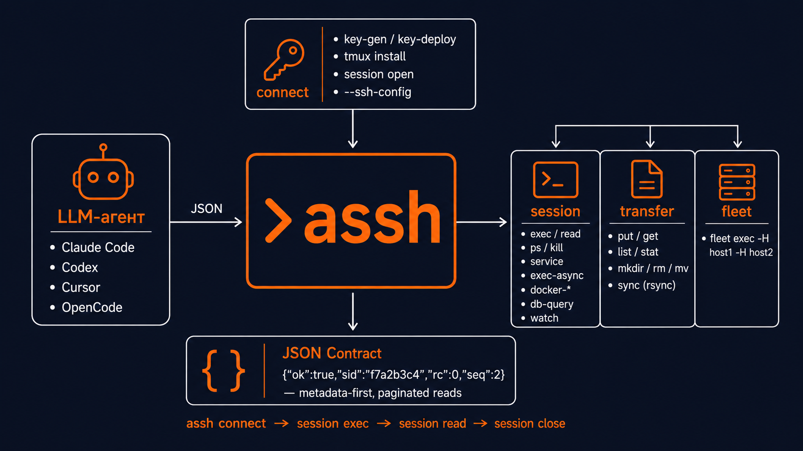

# assh

[](https://github.com/izzzzzi/agent-assh/actions/workflows/ci.yml)
[](https://github.com/izzzzzi/agent-assh/releases)
[](https://www.npmjs.com/package/agent-assh)
[](LICENSE)

Язык: Русский | [English](README.en.md)

SSH-инструмент для LLM-агентов.

`assh` подготавливает SSH-доступ, открывает persistent `tmux`-сессию на сервере и не тащит большой вывод в контекст агента. Команды сначала возвращают компактный JSON с метаданными, а агент читает только нужные строки.

<p align="center">
  
</p>

## Быстрый старт

```bash
npm i -g agent-assh

# вход по ключу
assh connect -H 203.0.113.10 -u root -i ~/.ssh/id_ed25519 -n deploy

# или первый вход по паролю: assh ставит свой ключ, дальше вход идёт по нему
export TARGET_PASS="..."
assh connect -H 203.0.113.10 -u root -E TARGET_PASS -n deploy
unset TARGET_PASS
```

Если вход по ключу уже работает, `assh connect` не читает `TARGET_PASS`.

Если есть блок с данными сервера от провайдера, сохраните его в локальный файл (mode `0600`) и дайте `assh` распарсить его:

```bash
assh connect-info --file server.txt -n deploy
```

При повторной работе с тем же хостом `--reuse` возвращает живую сессию с тем же хостом, пользователем, ключом и профилем вместо открытия новой. Если такой нет, выполняется обычный bootstrap:

```bash
assh connect -H HOST -u USER -i KEY -n deploy --reuse
```

`connect` возвращает session id и `next_commands`:

```json
{
  "ok": true,
  "host": "203.0.113.10",
  "user": "root",
  "identity": "/home/me/.ssh/id_ed25519",
  "key_deployed": false,
  "key_verified": true,
  "tmux_installed": true,
  "sid": "f7a2b3c4",
  "session": "deploy",
  "tmux_name": "assh_f7a2b3c4",
  "next_commands": {
    "exec": "assh session exec -s f7a2b3c4 -- pwd",
    "read": "assh session read -s f7a2b3c4 --seq 1 --limit 50",
    "list": "assh session list",
    "close": "assh session close -s f7a2b3c4"
  }
}
```

Дальше работайте через session API:

```bash
assh session exec -s f7a2b3c4 -- "pwd"
# {"ok":true,"rc":0,"seq":1,"stdout_lines":1,"stderr_lines":0,...}
assh session read -s f7a2b3c4 --seq 1 --limit 50
assh session close -s f7a2b3c4
```

`transfer` и `exec` адресуются по хосту, а не по сессии: передавайте им `-H`, `-u` и `identity` из ответа `connect` как `-i`.

Для скриптов через heredoc/stdin используйте явный bounded-режим (до 4 MiB):

```bash
cat script.sh | assh session exec -s f7a2b3c4 --stdin -- "bash -s"
```

`session exec` по умолчанию ждёт 300 секунд (`-t СЕКУНДЫ`). После `timeout` команда продолжает выполняться в сессии, поэтому не повторяйте её вслепую: прочитайте её `seq` позже. Долгую работу или работу без известной длительности запускайте как задачу:

```bash
assh session exec-async -s f7a2b3c4 -- "make build"
assh session job-status -s f7a2b3c4 --job-id JOB_ID   # статус, rc, последние строки вывода
assh session job-cancel -s f7a2b3c4 --job-id JOB_ID
```

`assh version --check` показывает, вышел ли более новый релиз.

## Установка скилла assh в AI-агентов

Скилл assh обучает AI-агентов использовать assh для SSH-работы. В нём только
инструкции: сам CLI ставится командой `npm i -g agent-assh`, и скилл подсказывает
агенту сделать это, если `assh` не найден.

| Агент | Установка |
| --- | --- |
| **Claude Code** | `/plugin marketplace add izzzzzi/agent-assh` затем `/plugin install assh@assh` |
| **Codex** | `codex plugin marketplace add izzzzzi/agent-assh` затем `codex plugin add assh@assh` |
| **Cursor** | Скопировать `.cursor/rules/assh.mdc` в `.cursor/rules/` проекта |
| **Cline** | Скопировать `.clinerules/assh.md` в `.clinerules/` проекта |
| **Copilot CLI** | `copilot plugin marketplace add izzzzzi/agent-assh` затем `copilot plugin install assh@assh` |
| **OpenCode** | Скопировать `skills/assh/` в `.opencode/skills/assh/` проекта или в `~/.config/opencode/skills/assh/` |
| **Pi** | `pi install git:github.com/izzzzzi/agent-assh` |
| **Любой агент** | Скопировать `AGENTS.md` в проект или вставить `SYSTEM_PROMPT_snippet.md` в системный промпт |

Через `ctx7`:

```bash
ctx7 skills install /izzzzzi/agent-assh assh
```

## Что делает connect

`assh connect`:

- использует ключ из `--identity` (по умолчанию `~/.ssh/id_agent_ed25519`) и создаёт его, если такого нет;
- сначала пробует вход по ключу;
- использует `--password-env` только если вход по ключу не сработал;
- добавляет публичный ключ и проверяет повторный вход по ключу;
- проверяет capabilities сервера;
- ставит `tmux` неинтерактивно, если не указан `--no-install-tmux`;
- безопасно чистит старые доверенные `assh`-сессии, если не указан `--no-gc`;
- открывает доверенную `tmux`-сессию и сохраняет локальную registry metadata.

## Команды

- `assh connect`: первый bootstrap и открытие session.
- `assh connect-info`: распарсить provider server-info block и подключиться.
- `assh prompt`: вывести инструкции для агента (тот же текст, что и в скилле). `assh --help` выводит JSON-манифест для агентов, `assh <команда> --help` — флаги.
- `assh session exec|read|close|gc`: persistent workflow через tmux.
- `assh session ps|kill`: управление процессами.
- `assh session service`: управление сервисами (status/restart/start/stop/logs).
- `assh session exec-async|job-status|job-cancel`: фоновые задачи.
- `assh session watch`: наблюдение за tmux-сессией агента человеком.
- `assh session list`: список локальных sessions из registry.
- `assh session export`: выгрузить session (transcript + outputs) в архив.
- `assh exec`: выполнить одну remote-команду и сохранить вывод локально.
- `assh read`: прочитать сохранённый вывод с пагинацией или через `--raw`.
- `assh transfer put|get|read|list|stat|mkdir|rm|mv|sync`: файловые операции и синхронизация. `transfer read` читает удалённый текстовый файл по ssh и возвращает `output_id` для постраничного `assh read`.
- `assh forward`: port forwarding (start/status/stop).
- `assh fleet exec`: параллельное выполнение на нескольких хостах; возвращает результат по каждому хосту и счётчик `failed`, вывод ограничен 8 КиБ на поток.
- `assh scan`: вернуть JSON-инвентарь хоста (OS, CPU, память, диск, uptime). Рассчитан на Linux: на других системах часть полей пустая.
- `assh capabilities`: проверить поддержку session workflow на сервере.
- `assh key-deploy`: низкоуровневая установка ключа через пароль из env.
- `assh audit`: читать локальный audit через `--last`, `--host`, `--failed`; `--savings` суммирует строки, удержанные пагинацией.
- `assh version`: вывести метаданные версии.

## Экономия токенов

Сначала смотрите метаданные, потом читайте нужные окна вывода:

```bash
assh session exec -s f7a2b3c4 -- "journalctl -p warning"
assh session read -s f7a2b3c4 --seq 1 --limit 50              # JSON: content, total_lines, has_more
assh session read -s f7a2b3c4 --seq 1 --offset 50 --limit 50  # следующая страница
assh session read -s f7a2b3c4 --seq 1 --stream stderr --limit 50
```

`--raw` выводит страницу обычным текстом без JSON-обёртки:

```bash
assh session read -s f7a2b3c4 --seq 1 --limit 50 --raw
```

Страницы считаются в строках, а не в байтах: одна очень длинная строка вернётся целиком, поэтому обрезайте её на сервере (`| cut -c1-500`).

`assh audit --savings` показывает, сколько строк вывода было удержано из контекста пагинацией (метрика в строках, не в токенах):

```bash
assh audit --savings
# {"ok":true,"reads":12,"raw_lines":5000,"served_lines":600,"withheld_lines":4400}
```

Числа суммируются по каждому чтению, поэтому при постраничном чтении одного вывода его длина учитывается по разу на страницу: это грубый индикатор.

## Примеры для agent CLI

Вставьте эту инструкцию в Codex, Claude Code, OpenCode или другой terminal agent перед передачей SSH-данных:

```text
Используй `assh` для SSH-задач.

Если я вставляю provider server-info block, сохрани весь блок во временный файл с mode 0600, выполни:
assh connect-info --file TMP -n NAME
затем удали TMP.

Если `connect-info` не смог распарсить блок, извлеки host, user и password сам. Пароль положи во временную environment variable и выполни:
assh connect -H HOST -u USER -E PASSWORD_ENV -n NAME
затем удали переменную.

Никогда не печатай, не логируй, не пересказывай и не повторяй пароли. Для всей remote-работы используй возвращенный sid и `next_commands`.
```

Короткие варианты для популярных CLI:

```text
Codex: Используй `assh` для всего SSH-доступа. Для вставленного server info сначала пробуй `assh connect-info --file TMP -n NAME`; не передавай секреты в command arguments и ответы.
```

```text
Claude Code: Перед SSH-работой установи/запусти `assh`. Если вставлены server credentials, сохрани их в 0600 temp file, выполни `assh connect-info --file TMP -n NAME`, удали файл и продолжай через returned sid.
```

```text
OpenCode: Используй `assh connect-info` для provider server-info blocks и `assh session exec/read` после connect. Никогда не echo пароли.
```

## Безопасность

- Пароль никогда не передаётся в аргументах команды: `connect` и `key-deploy` принимают имя env-переменной (`-E`), `connect-info` читает блок провайдера из файла или stdin. Флага `--password` нет.
- Если вход по ключу работает, `connect` не читает password env var.
- Значения паролей не пишутся в audit logs. Текст команд туда тоже не пишется — сохраняются хэши. Локальный transcript сессии текст команд хранит, поэтому не вставляйте секреты в команды.
- Вывод по умолчанию проходит редактирование секретов → `[REDACTED:type]`, в JSON появляется `"redacted":true`: AWS-ключи, JWT, bearer-токены, PEM-ключи, токены провайдеров (`ghp_`, `xoxb-`, `sk-`), пароли в URL и присваивания `*password*`/`*secret*`/`*token*`/`*api_key*`. Это гигиена по лучшему усилию, **не** механизм безопасности. Отключается флагом `--no-redact` (есть у `exec`, `session read`, `session job-status`, `transfer read`).
- `session exec`, `session exec-async`, `exec` и `fleet exec` прогоняют команду через классификатор, который блокирует явно destructive-команды: `rm -r`, `rm` на системных путях, `find ... -delete`, `mkfs`, `wipefs`, опасный `dd`, рекурсивную смену прав и редиректы в системные пути. `transfer rm` отказывается удалять системные пути.
- `--confirm-danger` для намеренного запуска есть только у `session exec`. У `exec`, `exec-async` и `fleet exec` такого флага нет by design: откройте session и используйте `assh session exec --confirm-danger`. Многохостовое destructive-выполнение намеренно невозможно.
- Классификатор сопоставляет шаблоны. Он не заглядывает в скрипты, переданные через `--stdin`, и в интерпретаторы, и не классифицирует `docker rm`, `DROP DATABASE`, `git reset --hard` и подобное. Это защита от случайностей; настоящая граница — права удалённой учётной записи.
- Декларативная политика безопасности: операторы могут добавить запрещённые команды в `~/.config/assh/safety.rules` (по одному имени команды в строке). Файл только **добавляет** запреты и не ослабляет встроенные правила; он должен иметь mode `0600` и принадлежать текущему пользователю, иначе fail-closed (`safety_policy_invalid`).
- По умолчанию ssh запускается без псевдотерминала (`-T`); `--force-pty` включает его для шлюзов, которым он нужен. С `--batch` ssh завершается ошибкой вместо запроса пароля или passphrase.
- `--host-key-policy accept-new` используется по умолчанию: хост считается доверенным при первом контакте, изменившийся ключ отклоняется. Для hardened окружений используйте `strict`. `no-check` небезопасен и подходит только для одноразовых lab/dev хостов.
- Remote cleanup удаляет только sessions с доверенной metadata `assh`.

Как сообщить об уязвимости — см. [SECURITY.md](SECURITY.md).

## Профили

`assh connect --profile readonly` или `--profile ops` ограничивает, что можно запускать в сессии; `admin` (по умолчанию) разрешает всё. Списки разрешённых команд лежат в `~/.config/assh/profiles.json`, при первом использовании файл заполняется значениями по умолчанию.

- `readonly`: чтение логов и статуса (`journalctl`, `tail`, `cat`, `grep`, `ls`, `df -h`, `systemctl status`, `docker ps`, `docker logs`, ...).
- `ops`: команды чтения плюс `systemctl restart|reload`, `docker restart`, `git pull`, `apt update`.

Профиль проверяется в `session exec`, `session exec-async`, `session service` и `session kill`. Разрешена должна быть каждая часть составной команды; подстановка команд и редирект в файл отклоняются. `exec`, `transfer` и `fleet` адресуются по хосту, а не по сессии, поэтому профиль на них не действует. Как и классификатор, профиль — защитное ограждение, а не граница безопасности.

## Плюсы

- Одна команда делает первый вход, ключ, tmux, cleanup и открытие session.
- ControlMaster connection pooling — повторные вызовы переиспользуют SSH-сокет.
- Большой вывод не попадает в контекст агента без явного чтения.
- Persistent sessions сохраняют рабочую директорию и окружение между командами.
- JSON-ответы стабильны для парсинга агентом.
- Встроенная проверка безопасности команд (safety classifier).
- Фоновые задачи через tmux (exec-async).

## Ограничения

- `tmux` sessions рассчитаны на Unix-like remote hosts.
- Установка пакетов неинтерактивная; неподдерживаемые package managers возвращают machine-readable errors.
- Интерактивные password prompts не поддерживаются в v1.
- `assh` использует системный OpenSSH client; для `transfer sync` на обеих машинах нужен ещё и `rsync`.
- `transfer list` и `transfer stat` требуют GNU `find`/`stat` на хосте; иначе возвращают `unsupported_remote`.
- С `--force-pty` stderr сливается со stdout, а шум терминала (баннеры, приглашения) вырезается эвристически.
- Выполняйте по одному `session exec` на сессию: команды делят один shell и идут по очереди.
- Одно SSH-соединение на хост переиспользуется 5 минут (ControlMaster). Изменения, которые действуют только на новый вход (членство в группах, настройки sshd), проявятся после его истечения.
- `session exec` пробрасывает локальный stdin только с флагом `--stdin` (до 4 МиБ, загружается во временный файл на сервере). Без флага piping вроде `cat f | assh session exec -s SID -- "docker exec -i ... cat >f"` отклоняется с `{"ok":false,"error":"stdin_pipe_unsupported",...}`, а не подвешивает tmux-окно. `assh exec` stdin не пробрасывает вовсе; для больших данных используйте `assh transfer put`.

## Ручная установка

`npm i -g agent-assh` ставит wrapper, который скачивает подходящий Go-бинарь из GitHub Releases. Архивы можно скачать вручную:

```text
https://github.com/izzzzzi/agent-assh/releases
```

Инсталлятор сверяет SHA-256 архива с `checksums.txt`, но берёт его из того же релиза. Это защищает от обрыва и порчи загрузки, но **не** от подмены релиза: независимой подписи (Sigstore/cosign) пока нет. Если вам нужна проверка происхождения, собирайте бинарь из исходников.

## English

See [README.en.md](README.en.md).
